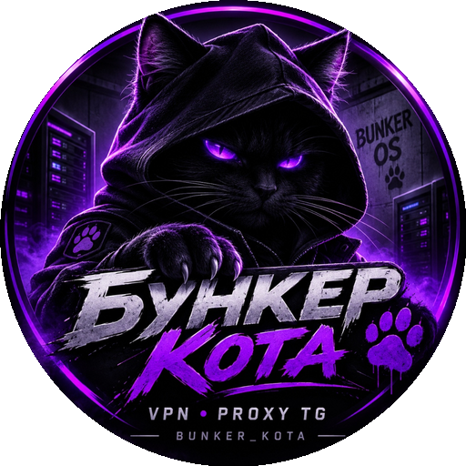

<!-- Cyberpunk Header Wave Banner -->

<!-- Animated Typing Text -->

 

<!-- Community & Contact Badges -->

  
  &nbsp;
  
  &nbsp;
  

---

### 🐈‍⬛ О проекте и экосистеме Бункера

Разрабатываю передовые решения для обхода блокировок, интеллектуальной маршрутизации и высокоскоростного туннелирования трафика:

* 🛡️ **[Bunker VPN (Android)](https://github.com/ANT1VEN0M/BunkerVPN)** — флагманский VPN-клиент на базе **Xray Core Lite**. Включает умный многопоточный балансировщик (Smart Balancer), неоновый Cyber-HUD спидометр, фильтры стран в 1 тап, бейджи задержки, встроенный белый список (БС) и тонкую настройку потоков пинга (до 128 потоков).
* ⚡ **Bunker Parser** — автономный высокоскоростной чекер и нормализатор прокси на базе Xray. Проверяет ключи на реальный доступ к целевым сервисам (**YouTube, Telegram, ChatGPT, Gemini**) с глубокой валидацией и экспортом в форматы МИКС / ЧС / БС.
* 🤖 **Bunker OS Bot** — распределительная бот-система в Telegram для безопасной и автоматизированной публикации конфигураций.

---

### 🛠 Стек технологий и протоколов

#### 🛰️ Протоколы туннелирования и обхода блокировок

-EF4444?style=flat-square&logo=speedtest&logoColor=white)

#### 💻 Разработка и архитектура

-00ADD8?style=flat-square&logo=go&logoColor=white)

---

### 🔥 Главный репозиторий

<table>
  <tr>
    <td width="30%" align="center">
      
    </td>
    <td width="70%">
      <h3><a href="https://github.com/ANT1VEN0M/BunkerVPN">⚡ Bunker VPN for Android</a></h3>
      
Сверхбыстрый, кастомизированный и стильный VPN-клиент нового поколения в стиле Cyberpunk с встроенным умным балансировщиком, live-мониторингом скорости, таймером сессий и гибким управлением потоками тестирования узлов.

      

        
        
        
      

    </td>
  </tr>
</table>

---

### 📊 Статистика активности на GitHub

  
  &nbsp;
  

 

  

---

  <i>«Свободный интернет без границ, цензуры и задержек»</i> ⚡ 
  <b>Бункер Кота © 2026</b>
  
    
  <!-- Cyberpunk Footer Wave Banner -->
  

